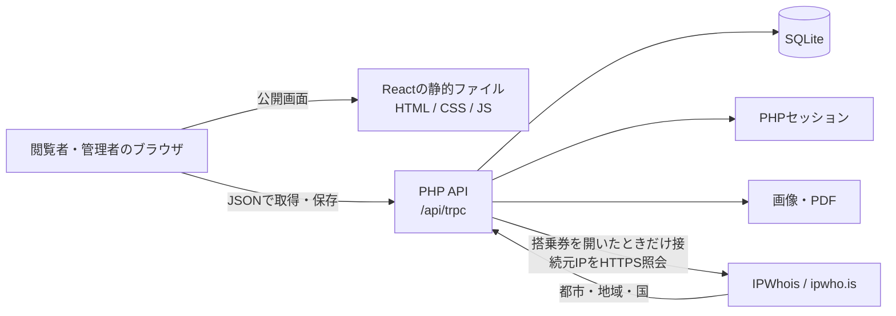

# 月春の資材置き場


作品、写真、日々の記録をまとめる個人ポートフォリオです。見た目だけでなく、コンテンツを自分で編集して長く運用できることを目指して、レンタルサーバー上で完結する小さな公開・管理システムとして実装しています。

技術を採用する理由、サーバー内のデータの流れ、主要コードの読み方は [技術とコードの日本語解説](docs/TECHNICAL-GUIDE.ja.md) にまとめています。

## どんなサイトか

公開側にはWorks、Gallery、Blog、Aboutを用意し、管理画面からプロフィール、作品、写真、記事、画像、PDFを更新できます。公開画面は余白と文字組を中心にした静かなアーカイブとして設計し、モバイルでは専用のハンバーガーメニューへ切り替わります。

Homeの「制作と日々の記録」は、各カテゴリの最新記録を優先した1行のプレビューです。画面幅に応じて1〜4件を表示し、投稿数の多いカテゴリだけが並ばないように選びます。記録の一覧はそれぞれのカテゴリページで閲覧できます。

Aboutの名前・アイコンを押すと、プロフィール情報を載せた搭乗券が、上部のプリンターから送り出されます。PCでは本券と半券が並ぶ横長の紙面、スマホでは縦配置に切り替えます。サイトのQRコード、2026年10月11日の公開日、X・GitHubのIDを載せ、動きを減らす設定やキーボード操作にも対応します。出発地は、開いたときに接続元IPをIPWhoisへHTTPSで照会して推定します。取得した地域は搭乗券表示にだけ使い、この機能から他の第三者へ提供しません。ページ下部にも取得先・目的・一時保存の説明を掲載しています。[プロフィール搭乗券の仕組み](docs/PROFILE-BOARDING-PASS.md)に実装をまとめています。

Galleryでは、元画像のEXIFから撮影日時、カメラ・レンズ、焦点距離、絞り値、シャッタースピード、ISO感度を自動入力します。単枚・一括アップロードの両方に対応し、読み取った値は編集可能です。撮影情報は画像とは別にDBへ保存し、公開Galleryの詳細にも表示します。使用方法と日時の扱いは [Galleryの撮影情報](docs/GALLERY-EXIF.md) を参照してください。

Aboutの音楽欄は、普段聴いている曲をアーティスト別に整理した一覧です。曲名とカバー・バージョンを文字中心に表示し、アーティスト名を開くとYouTubeへのリンクを閲覧できます。ライブラリーの資料と整理基準、管理画面での編集方法は [音楽ライブラリーの記録](docs/MUSIC-LIBRARY.md) にまとめています。

Aboutの使用機材には、パソコン、スマートフォン、タブレット、音楽機器、カメラ、その他の道具を登録できます。種類に応じた仕様、組み合わせ、用途・使い心地、写真を管理画面から編集でき、公開ページにも種類別に表示します。従来のパソコンデータはそのまま使用でき、種類未設定のデータはパソコンとして扱います。追加のデータベース移行は不要です。

バックエンドには、個人サイトの更新頻度と規模に合うPHPとSQLiteを採用しています。外部CMSやクラウドDBを増やさず、サイトのデータ、ログイン状態、アップロードメディアをXServer内で管理する構成です。

## 技術構成

Node.jsはローカルでのフロントエンドビルドとテストにだけ使います。公開環境でNode.jsのプロセスを常駐させる必要はありません。

## アーキテクチャ



Reactのクライアントは同一ドメインの `/api/trpc` にJSONリクエストを送ります。PHPは受け取った手続きを振り分け、SQLiteを読み書きして、SuperJSONのメタデータを含むレスポンスを返します。フロントエンド側の型付きクエリとキャッシュの扱いを維持しつつ、レンタルサーバーで動くPHP実装に置き換えるためのアダプターとして設計しています。

管理画面の更新も同じ経路です。ログイン済みのブラウザからPOSTされたデータをPHPが検証し、SQLiteへ保存します。公開ページでは公開状態のレコードだけを返します。

搭乗券の出発地取得だけは外部のIPWhoisを使用します。GPSは使わず、ブラウザへは都市・地域・国だけを返します。取得できない場合は「YOUR CITY」に切り替え、搭乗券の表示とQRコードの利用を続けられます。照会結果は非公開セッションに一時保存し、プロフィールや投稿には保存しません。

## データとファイルの置き場所

公開ディレクトリと、公開してはいけない情報を分けています。

```text
<XServerの契約領域>/
  portfolio-private/                 # HTTPから到達しない領域
    config.php                        # 許可オリジン、管理者パスワードハッシュ
    portfolio.sqlite                  # コンテンツと運用データ
    sessions/                         # PHPログインセッション
  public_html/                        # 公開ディレクトリ
    index.html
    assets/                           # Viteが出力するハッシュ付きアセット
    api/                              # PHP API
    uploads/                          # 管理画面から追加した画像・PDF
    .htaccess                         # SPA/APIのルーティング
```

SQLiteにはプロフィール、Works、Gallery、Blog記事、訪問者名、コメント、いいね、レート制限のカウンターを保存します。廃止したBooksの旧レコードも保管したままですが、公開・管理APIからは利用しません。画像・PDFはデータベースへ直接格納せず、`uploads` にランダムな名前で保存し、コンテンツ側にはそのURLを持たせます。これにより、DBのバックアップとメディアのバックアップを独立して扱えます。

`PORTFOLIO_PRIVATE_DIR` を設定すれば、プライベート領域の位置を環境に合わせて変えられます。

## メディア処理と安全性

画像アップロード時は、ブラウザ側の最適化に加えてPHP側でもMIMEタイプと解像度を確認します。GDで最大辺1600pxに縮小・再エンコードし、対応環境ではより小さくなる場合にWebPを使います。PDFはサイズ、MIMEタイプ、ファイルシグネチャを確認してから保存し、ブラウザでの直接実行ではなくダウンロードとして配信します。

管理者認証にはPHPのパスワードハッシュとサーバーサイドセッションを使います。更新系のAPIはPOST、同一オリジン確認、専用ヘッダーを要求し、ログイン、コメント、いいねにはSQLiteに記録するレート制限があります。セッションCookieには `HttpOnly` と `SameSite=Lax` を付与し、HTTPSでは `Secure` も有効になります。

## 運用の考え方

ビルドでは、初回設置用の `dist/public` と、継続更新用の `dist/update` を分けて生成します。Windowsでは更新用の `dist/update.zip` も生成します。更新パッケージには静的ファイル、PHP API、ハッシュ付きアセットだけを含め、投稿画像が入る `uploads` は含めません。

更新は既存の `public_html` にパッケージの中身を上書きする方式です。公開フォルダ全体の削除・置き換えや、ローカルにないファイルを削除する同期は行いません。`portfolio-private` と `uploads` が持つコンテンツと運用状態を保持するため、アプリの配布物とサーバーで増えるデータを分離しています。更新と画像復旧の手順は [XServer運用ガイド](docs/XSERVER.md#継続更新と画像の復旧) にまとめています。

バックアップでは、SQLite、`uploads`、プライベート設定を一組として扱います。コンテンツだけを移す場合には、`xserver/manage.php` がJSON形式のexport/importを提供します。SQLiteを使うことで、個人ポートフォリオに必要な単一サーバー上のシンプルさと、データの持ち運びやすさを両立しています。

## リポジトリ案内

| 場所 | 内容 |
| --- | --- |
| `client/` | React画面、コンポーネント、スタイル、SVGロゴ |
| `client/src/pages/` | Home、Works、Gallery、Blog、About、Adminのページ |
| `xserver/public/api/` | PHP API、認証、SQLiteアクセス、入力検証、メディア処理 |
| `xserver/public/.htaccess` | ApacheでのSPAとAPIのURL振り分け |
| `xserver/manage.php` | 初期化、パスワードハッシュ、コンテンツのexport/import |
| `scripts/` | 配布物の生成と、PHP・ブラウザ検証 |

## 開発・検証

ローカルではViteとPHPの開発サーバーを並行して起動します。

```sh
pnpm install --frozen-lockfile
php xserver/manage.php init http://127.0.0.1:5173
pnpm dev:api
# 別のターミナルで
pnpm dev
```

```sh
pnpm check
pnpm test
pnpm test:release
pnpm build
node scripts/test-xserver.mjs
```

レスポンシブ検証は320、375、430、768、1024、1440pxで、公開ページ、管理画面、メニュー、キーボード、タッチ操作、`prefers-reduced-motion` を確認します。Homeのカテゴリ選択は単体テストでも確認しています。

2026年10月10日の変更ではTypeScript、26ファイル94件のVitest、配布用ビルドが通過しました。Homeの1行表示は検証用APIレスポンスを使い、境界幅を含む11画面幅で確認しています。PHP/API統合、既存ブラウザフロー、186件のレスポンシブ検証の直近の実施日は10月9日です。

10月11日の更新パッケージ変更では、型チェック、既存94件のテスト、配布処理の追加3件のテスト、ビルドが通過しました。更新ZIPの内容と、既存画像を残したまま展開できることをローカルで確認しています。Apacheの404設定と実サーバー上の展開・画像復旧は未検証です。

同日の自己紹介ページ更新では、Skills・Personalを公開・編集画面から外し、音楽ライブラリーを163件に整理しました。型チェック、27ファイル97件のVitest、配布処理3件のテスト、ビルドが通過しています。音楽一覧は検証用プロフィール応答を使ったChromeで6画面幅、文字のはみ出し、キーボード・タッチ操作、動きを減らす設定を確認しています。ローカルのPHP実行がWindowsの実行制限により利用できないため、今回の初期データ補完・SQLite保存の追加テストと実サーバーでの反映は未検証です。

使用機材への拡張では、型チェック、28ファイル101件のVitest、ビルドが通過しています。Chromeと検証用APIを使い、6種類の追加・保存・再読込、種類変更時の既存情報の保持、公開ページでの表示、6画面幅での文字のはみ出しと選択欄の大きさを確認しました。PHP・SQLiteの追加テストと実サーバーでの保存は未検証です。

10月13日のGallery EXIF対応では、型チェック、29ファイル110件のVitest、配布処理3件のテスト、PHPの19項目、ビルドが通過しました。ローカルのPHPと分離したSQLiteを使うChrome検証で、単枚の自動入力・手動修正・保存・再読込、一括登録時の写真ごとの撮影情報、EXIFなしの画像、公開ページと拡大表示、キーボード操作、動きを減らす設定を確認しています。公開・編集画面とも6画面幅で横方向のオーバーフローがないことを確認しました。公開XServerへの展開と実機Safariでの動作は未検証です。

詳しいXServerへの導入・バックアップ手順は [docs/XSERVER.md](docs/XSERVER.md)、UI/UXの改善記録は [docs/UI-UX-AUDIT.md](docs/UI-UX-AUDIT.md) にまとめています。

10月26日にBooksを公開・管理・検索機能から撤去し、Aboutにプロフィール搭乗券を追加しました。出発地のIP推定、本券と半券の紙面、ページ下部のプライバシー説明にも対応しています。型チェック、31ファイル119件のVitest、配布処理3件、PHPの38項目、認証・CRUD・アップロード・バックアップ復元のAPI統合検証が通過しています。Chromeで6画面幅、長い都市名・通信失敗、初回発行時だけの照会、印刷アニメーション、動きを減らす設定、SVGのQR復号、キーボード・タッチ操作を確認しました。地域の成功表示は制御したAPI応答、実通信は公開DNSの既知IPを使ったPHPのHTTPS照会でそれぞれ検証しています。公開環境への反映と実機Safariは未検証です。
