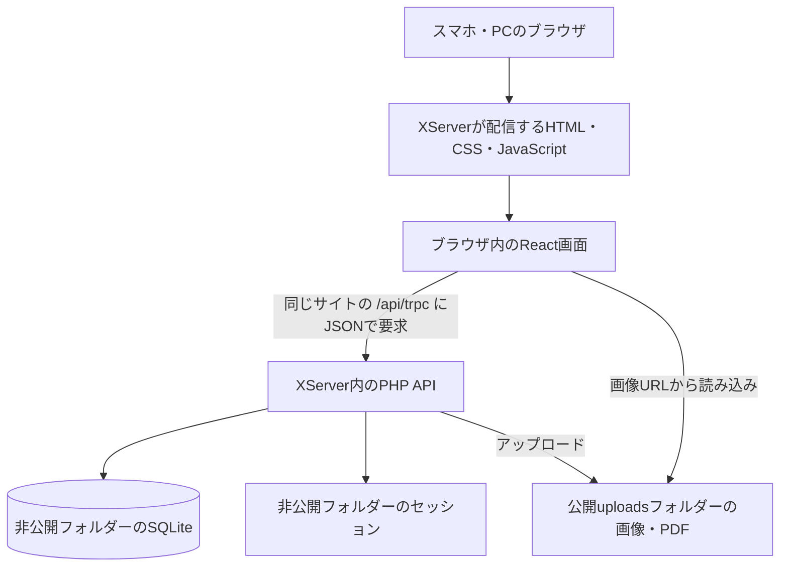
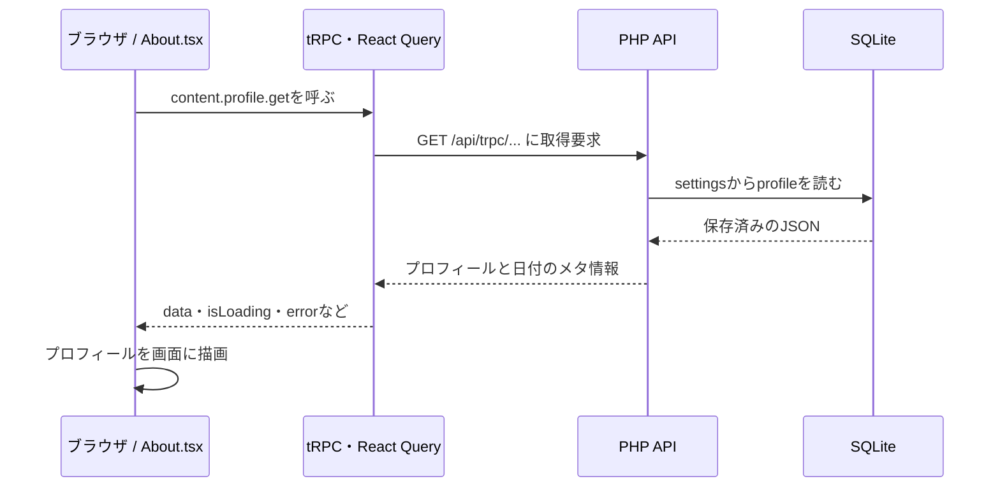

# 月春の資材置き場 ― 技術とコードの読み方

この文書は、サイトの持ち主が「何を使っていて、どこにデータがあり、コードのどこを変えると何が変わるのか」を理解するための解説です。2026年10月26日時点のリポジトリをもとにしています。

技術を選んだ理由は、現在の実装とXServerでの運用条件に照らした説明です。すべてのライブラリーについて、最初に導入した人の判断や当時の経緯が記録されているわけではありません。

## 1. まず全体像

このサイトには、大きく分けて三つの仕事があります。

1. **見せる**：ブラウザでReactがページやメニューを組み立てる。
2. **受け付ける**：PHPが「記事を取得する」「プロフィールを保存する」といった要求を処理する。
3. **残す**：SQLiteに文章や設定を保存し、画像・PDFはサーバーのフォルダーに保存する。



**Reactは閲覧者の端末で動き、PHPはXServerで動きます。** SQLiteファイルをブラウザが直接読むことはありません。PHPが必要なデータだけを取り出してJSONで返します。JSONは、文章・数値・配列などを通信しやすい形にしたデータ形式です。

## 2. 技術スタックと、その構成にする理由

PHPとSQLiteを使うことは、すべてのサイトに最適という意味ではありません。このサイトでは「個人で更新し、XServer内で運用を完結させる」という条件に合っています。利用規模が大きくなれば、DBや配信方式を見直す余地があります。

## 3. データはどこにある？

公開ファイルと、外から見せてはいけないファイルを分けています。標準構成のイメージは次のとおりです。非公開フォルダーの場所は、環境変数`PORTFOLIO_PRIVATE_DIR`でも指定できます。

```text
サーバーのサイト用ディレクトリー
├─ public_html/                  ← Webから配信する場所
│  ├─ index.html
│  ├─ assets/                    ← ビルドされたCSS・JS・ロゴなど
│  ├─ api/                       ← PHP API
│  └─ uploads/                   ← 管理画面から追加した画像・PDF
└─ portfolio-private/            ← 公開範囲の外
   ├─ config.php                 ← サイト設定
   ├─ portfolio.sqlite           ← データベース本体
   └─ sessions/                  ← PHPのログイン状態
```

SQLiteは一つのファイルを中心に動くDBですが、稼働中にはWALなどの補助ファイルも発生します。バックアップ時には書き込みを止めるなど、整合性を保った取得が必要です。稼働中にDB本体だけをコピーすると、最新の書き込みを取り逃す可能性があります。

DBの主なテーブルは、[bootstrap.php](../xserver/public/api/bootstrap.php)で定義しています。

| テーブル | 保存する内容 |
| --- | --- |
| `settings` | プロフィール、管理者パスワードのハッシュなどの設定 |
| `records` | 作品・写真・ブログ記事（過去の本のレコードは保管）。`kind`で種類を区別し、`payload`にJSONを保存 |
| `visitors` | 訪問者の表示名など |
| `likes` | 記事と訪問者に対応する「いいね」 |
| `comments` | 記事へのコメント、編集・削除に関する情報 |
| `attempts` | ログインなどの試行回数を制限するための情報 |

例えばカメラを追加しても、DBに「カメラ専用の列」を増やす必要はありません。プロフィールのJSON内に、機材の種類・名前・仕様・メモを保存します。その分、JSONの構造をTypeScriptとPHPの両方で検証する必要があります。

**画像そのものはDBには入りません。** `uploads`に画像ファイルを保存し、DBには`/uploads/……webp`などのURLを保存します。DBだけ残って画像ファイルがなくなると、文章は表示できても画像は表示できません。以前、更新時の置き換えで画像が消えたのは、この二つが別々に保存されているためです。

## 4. 自己紹介ページが表示されるまで



[About.tsx](../client/src/pages/About.tsx)の取得部分は、次の形です。

```tsx
const query = trpc.content.profile.get.useQuery(undefined, {
  staleTime: 60_000,
});
const p = query.data ?? defaultProfile;
```

- `useQuery`は、データを**読む**ためのReactの仕組みです。
- `undefined`は、この取得には検索条件などの引数が不要という意味です。
- `staleTime: 60_000`は、取得したデータを60秒間は新しいものとして扱う設定です。60秒ごとの自動更新タイマーではありません。
- `query.data`に取得結果が入ります。
- `??`は、左側が`null`または`undefined`なら右側を使う記号です。まだ結果がない場合は`defaultProfile`を使います。

同じページには読み込み・エラーの表示もあります。初期値を使えることと、通信が成功したことは別です。

通信の共通設定は[main.tsx](../client/src/main.tsx)にあります。

```tsx
httpBatchLink({
  url: "/api/trpc",
  transformer: superjson,
  headers: { "X-Portfolio-Request": "1" },
  fetch: (input, init) =>
    fetch(input, { ...init, credentials: "same-origin" }),
})
```

`/api/trpc`は、今開いているサイトと同じ配信元への相対URLです。`credentials: "same-origin"`により、その配信元のCookieも通信に含めます。管理者のログイン状態をサーバーが確認するために必要です。`httpBatchLink`は複数のAPI要求をまとめる機能、`superjson`は日付などの復元を担当します。

`X-Portfolio-Request`は、PHPが更新要求を確認するときに使うヘッダーです。管理者かどうかは、このヘッダーだけで判断せずセッションでも確認します。

## 5. 自己紹介を編集して保存するまで

[ProfileEditor.tsx](../client/src/components/ProfileEditor.tsx)では、取得したプロフィールを編集用の状態に入れます。

```tsx
const [p, setP] = useState<Profile>(defaultProfile);
```

`p`は現在の入力内容、`setP`は入力内容を更新する関数です。ここにある情報は、保存ボタンを押すまでは基本的にブラウザ内の下書きです。

```tsx
const patch = (values: Partial<Profile>) => {
  setP(current => ({ ...current, ...values }));
  save.reset();
  setError("");
};
```

`Partial<Profile>`は、プロフィールの一部分だけを渡せる型です。`...current`で今の内容を引き継ぎ、`...values`で変更した項目を上書きします。既存のオブジェクトを直接書き換えるのではなく、新しいオブジェクトを作ってReactに変更を伝えます。

保存処理の流れは次のとおりです。

1. フォーム送信時に、Zodの`profileSchema.safeParse`で内容を確認する。
2. 問題があれば入力エラーを表示する。
3. 通れば`save.mutate(...)`でPHP APIへ送る。
4. PHPがHTTPメソッド・配信元・管理者セッションを確認し、データを再検証する。
5. SQLiteの`settings`へプロフィールJSONを保存する。
6. 成功したら公開・管理画面の関連キャッシュを無効化する。

```tsx
const save = trpc.admin.content.profile.update.useMutation({
  onSuccess: () => {
    utils.content.profile.get.invalidate();
    utils.admin.content.profile.get.invalidate();
  },
});
```

`useMutation`は、データを**変更する**ための仕組みです。`invalidate()`は、手元のキャッシュを更新対象にする処理です。他の閲覧者全員の画面がその瞬間に強制更新される仕組みではなく、他の端末では再取得や再読み込み後に反映されます。

音楽の編集欄は、全体をHTMLの`<details>`で折りたためます。閉じても内部の入力欄を取り除かないため、途中の編集内容を保ち、そのまま保存できます。公開ページのアーティスト別の折りたたみも同じHTMLの仕組みです。

## 6. PHP APIのコードを読む

入口は[index.php](../xserver/public/api/index.php)、処理の振り分けは[procedures.php](../xserver/public/api/procedures.php)、DB・認証・検証などの共通処理は[bootstrap.php](../xserver/public/api/bootstrap.php)です。

```text
HTTP要求
  → index.php：要求のJSONを読む
  → procedures.php：操作名に応じて処理を選ぶ
  → bootstrap.php：DB・認証・入力検証などを使う
  → index.php：結果またはエラーをJSONにして返す
```

プロフィールの更新は`admin.content.profile.update`という操作名に対応します。共通の検証や権限確認を省略すると、保存の中心部分は次の形です。

```php
saveSetting('profile', array_replace(
    profileInput($input),
    ['_musicLibraryInitialized' => true]
));
```

`profileInput`が入力内容を検証・整形し、`saveSetting`がDBへ保存します。`_musicLibraryInitialized`は、音楽欄を意図的に空にしたときに、初期ライブラリーが復活しないための内部情報です。公開APIの返却時には取り除かれます。

SQLの実行にはPDOを使い、値をプレースホルダーへ渡す方式を採っています。SQL文へ入力文字列をそのまま連結することを避けるためです。書き込み処理ではトランザクションも使い、ひとまとまりの変更の途中で不整合が残ることを抑えています。

### tRPCなのにPHPで動く理由

[trpc.ts](../client/src/lib/trpc.ts)には、次の宣言があります。

```ts
import type { AppRouter } from "../../../server/routers";
export const trpc = createTRPCReact<AppRouter>();
```

`import type`は開発時の型情報だけを読み込みます。公開用JavaScriptにNode.jsサーバーを組み込む命令ではありません。

現在のPHP APIは、tRPCクライアントが期待する要求・返却形式を実装しています。PHP用tRPCライブラリーで自動生成しているわけではありません。したがって、TypeScriptのAPI型を変えたらPHP側の処理や検証も合わせて変更する必要があります。型チェックだけでは、この両者の一致を完全には保証できません。

## 7. ログイン、Cookie、安全性の仕組み

管理者のログイン状態はPHPセッションで管理します。ブラウザにはセッションを識別するCookieを渡し、ログイン情報の本体は非公開の`sessions`フォルダーに保存します。

- パスワードはハッシュで扱い、平文のままDBへ保存しません。
- ログイン時にはセッションIDを更新します。
- 管理者操作では、セッションの有効期限と現在の認証情報を確認します。
- Cookieには`HttpOnly`、`SameSite=Lax`を設定し、HTTPS時は`Secure`を設定します。
- 更新要求はPOSTに限定し、専用ヘッダーやOriginなども確認します。
- 試行回数を制限する処理、入力検証、記事HTMLのサニタイズもあります。

`HttpOnly`は通常のJavaScriptからCookieを読み取れない設定、`Secure`はHTTPSで送る設定です。サニタイズは、記事に不要なタグや危険な属性が入り込まないよう整える処理です。これらを重ねて使っていますが、「どんな攻撃にも安全」という意味ではありません。

訪問者名の登録と管理者ログインは別の仕組みです。訪問者の名前は本人確認済みのアカウントではなく、外部OAuthによる身元確認も行っていません。

## 8. 画像とPDFのアップロード

画像は、ブラウザ側で容量を抑えてから送信し、PHP側でも内容を検証します。画像用APIではBase64という文字列形式で画像データを渡します。PDFには別のアップロード入口[media.php](../xserver/public/api/media.php)があります。

Galleryでは容量を抑える前に、ブラウザ内でExifReaderを使って元画像のEXIFを読みます。撮影日時・カメラ・レンズ・焦点距離・絞り値・シャッタースピード・ISO感度を入力欄へ反映し、確認後に画像URLと一緒にDBへ保存します。画像の変換でEXIFが失われても、保存した撮影詳細を表示できる構成です。仕組みと日時の扱いは[Galleryの撮影情報](GALLERY-EXIF.md)を参照してください。

PHPの`uploadMedia`は、おおむね次の順で処理します。

1. 容量を確認する。画像は5MB、PDFは10MBが上限。
2. `fileinfo`で実際のファイル形式を確認する。
3. 画像の場合は寸法や画素数を確認する。
4. GDで読み込み、長辺を最大1600pxへ縮小して再保存する。
5. 条件に応じてJPEG・PNG・WebPを使い、ランダムな名前で保存する。
6. `/uploads/ファイル名`というURLを返す。
7. 編集フォームが、そのURLを作品やプロフィールのデータとして保存する。

ユーザーの元のファイル名をそのまま公開URLにしないので、同名ファイルの衝突を避けられます。画像の保存と、画像URLを含むコンテンツの保存は別の処理です。

## 9. 画面を構成する主なファイル

| ファイル | 読むと分かること |
| --- | --- |
| [App.tsx](../client/src/App.tsx) | URLとページの対応、ページの遅延読み込み、共通プロバイダー |
| [TsukiLayout.tsx](../client/src/components/TsukiLayout.tsx) | ロゴ、ナビゲーション、スマホメニュー、共通レイアウト |
| [About.tsx](../client/src/pages/About.tsx) | 自己紹介の各欄をどの順番で表示するか |
| [ProfileEditor.tsx](../client/src/components/ProfileEditor.tsx) | 管理画面でプロフィールを編集・保存する処理 |
| [profile.ts](../shared/profile.ts) | プロフィール、曲、機材などの型と初期値 |
| [profileSchema.ts](../shared/profileSchema.ts) | 保存可能な入力形式や件数の上限 |
| [devices.ts](../shared/devices.ts) | 機材の種類、表示名、仕様欄の切り替え |
| [DeviceCard.tsx](../client/src/components/DeviceCard.tsx) | 公開ページで機材をどう見せるか |
| [MusicLibrary.tsx](../client/src/components/MusicLibrary.tsx) | アーティストごとの曲の整理と折りたたみ |
| [homeUpdates.ts](../client/src/lib/homeUpdates.ts) | Homeに載せる項目を偏らないように選ぶ処理 |
| [vite.config.ts](../vite.config.ts) | 開発用プロキシ、パスの別名、ビルド先 |

### スマホメニュー

`TsukiLayout`はRadixのSheetを使い、画面幅が768px未満のときにモバイルのメニューを表示する構成です。ページを移動したときやPC幅に切り替わったときにはメニューを閉じます。見た目の調整だけでなく、開閉状態をReactで管理しています。

### Homeの「1行だけ」

`buildHomePreview`は、更新日時順に並べてから種類ごとにグループ化します。最初に各種類の最新1件を候補にし、枠が余ったら各種類の2件目を選び、最大4件まで用意します。画面幅に応じて表示件数を1〜4件に調整するため、投稿数の多い種類だけでHomeが埋まることを避けられます。

### 機材の種類

機材は`computer`、`smartphone`、`tablet`、`audio`、`camera`、`other`で区別します。旧データのように種類が未設定ならパソコンとして扱います。スマホなどにはOS・CPUの欄を使い、カメラや音楽機器は自由記述の仕様や組み合わせを中心に表示します。

### 音楽の初期データ

[music-library.json](../xserver/public/api/music-library.json)は、提供された資料から整理した初期データです。保存済みプロフィールに音楽がなく、まだ編集で確定していない場合に読み込みます。通常の閲覧だけでDBを書き換えることはありません。管理画面で保存した後は、その内容を優先します。資料・リンクの整理方針は[音楽ライブラリーの記録](MUSIC-LIBRARY.md)を参照してください。

### 搭乗券の出発地を取得する流れ

Aboutの名前・アイコンを押すと、[BoardingPass.tsx](../client/src/components/BoardingPass.tsx)が`content.departure.get`を呼びます。ページを読むだけでは地域照会を行いません。ブラウザのGPS権限も使用しません。

PHPの[departure.php](../xserver/public/api/departure.php)は、Webサーバーが渡す`REMOTE_ADDR`を使い、`https://ipwho.is/<接続元IP>`へHTTPSで照会します。ブラウザが自由に指定できるIPや、信頼していない転送ヘッダーは使いません。外部データをそのまま画面へ転送せず、都市・地域・国だけを取り出します。緯度・経度・IP・プロバイダー情報は返しません。現在の直接接続のXServer構成を前提としており、CDN・リバースプロキシを導入する場合は信頼する接続元の扱いを別途設計する必要があります。

IPWhoisを選んだ理由は、必要な地域情報をHTTPSの小さなJSON応答で取得でき、GPSやAPIキーを必要としないためです。一方、IPは通信事業者の拠点やVPNの出口を示す場合があり、実際の居場所・最寄り空港を確定できません。そのため市名・地域名を「IP推定」として表示し、空港コードは推測しません。[提供元の仕様](https://ipwhois.io/documentation)にある無料枠・障害などの制約もあるので、失敗時には「YOUR CITY」に戻します。

成功した結果は同じセッションとIPで6時間、失敗は5分間キャッシュし、PHPではIP単位の照会回数にも上限を設けます。非公開セッションに推定地域・接続元IPのハッシュ・有効期限を保持し、既存の`attempts`表には回数制限用のハッシュと回数・時刻だけを記録します。推定地域をプロフィールや投稿データに書き込む処理はありません。取得した地域は搭乗券表示専用で、この機能からIPWhois以外へ提供しません。一般のWebサーバーのアクセスログや提供元による処理とは区別した説明です。

PCでは本券と半券を横に並べ、640px以下では縦に切り替えます。紙の輪郭とQRはSVG、文字はHTMLなので、文字を読み上げ・選択できます。細かな仕組みと検証範囲は[プロフィール搭乗券](PROFILE-BOARDING-PASS.md)を参照してください。

## 10. URLを直接開いても表示できる理由

React側のWouterと、サーバー側の[.htaccess](../xserver/public/.htaccess)が別々の役割を持ちます。

| 開いたURL | Apache側の処理 | ブラウザ側の処理 |
| --- | --- | --- |
| `/about` | 実ファイルがなければ`index.html`を返す | WouterがAbout画面を表示 |
| `/api/trpc/...` | PHP APIの入口へ振り分ける | 返ってきたJSONを画面のデータに使う |
| `/assets/....js` | 実ファイルを配信 | JavaScriptを実行 |
| `/uploads/....webp` | 実ファイルを配信。なければ404 | 画像として表示 |

`/about`のようなURLに専用のHTMLファイルがあるわけではありません。一つの入口HTMLから、URLに応じて画面を切り替える方式をSPAと呼びます。存在しない画像を`index.html`へ回さないのも大切で、画像がないときは正しく404にします。

## 11. 開発・ビルド・公開・データ更新の違い

| 操作 | 変わるもの | 再ビルド |
| --- | --- | --- |
| 管理画面で自己紹介・曲・機材・記事を保存 | サーバーのDB | 不要 |
| 管理画面から写真・PDFをアップロード | サーバーの`uploads`と、保存した参照URL | 不要 |
| ReactやCSSを修正 | ソースコード | 公開用ファイルの作成に必要 |
| PHPのAPI処理を修正 | サーバー側の処理 | 配布物へ含めてサーバーに反映する必要あり |
| GitHubへpush | GitHub上のコードと文書 | それだけではXServerへ反映されない |

`pnpm build`はViteで画面をビルドし、配布用スクリプトでPHPなどをまとめます。[package-xserver.mjs](../scripts/package-xserver.mjs)と[xserver-release.mjs](../scripts/xserver-release.mjs)が配布物を作ります。

通常の更新には`dist/update.zip`を使います。この更新用パッケージは`uploads`を含めず、非公開のDB・設定も含めません。サーバーのフォルダー全体を削除して入れ直すと、パッケージにない運用データまで失うため、更新対象を上書きします。具体的な手順は[XServer運用ガイド](XSERVER.md)にまとめています。

ローカル開発ではViteが`/api`と`/uploads`をPHP開発サーバーへ転送する設定があります。公開時にはApacheが直接PHPや画像を扱います。この「開発時の転送」と「公開時の配信」は別の仕組みです。

## 12. 以前の仕組みと、今の仕組みの見分け方

`server/`や`drizzle/`には、以前のNode.js・MySQL向けコードなどが残っています。`package.json`にも以前の構成に関連する依存パッケージがあります。**パッケージ一覧にあるだけで、公開サイトがそのサービスへ接続しているとは限りません。**

現在のXServer用配布では、PHP APIとSQLite、ローカルのアップロードフォルダーを使います。Node.jsサーバー、MySQL、S3などの外部ストレージ、外部OAuthをこの公開構成の稼働サービスとして扱う説明は適切ではありません。

一方で、`server/routers`の型はフロントエンドのAPI型に使われており、一部のコードはテストにも関係します。「公開サーバーで動かない」ことと「削除してよい」ことは同じではありません。古い説明は[LEGACY-README.md](LEGACY-README.md)に分離されています。

## 13. コードを読み始めるおすすめの順番

最初から全ファイルを理解する必要はありません。「自己紹介を表示し、編集して保存する」一本の流れを追うと、他のページも読みやすくなります。

1. `shared/profile.ts`で、プロフィールにどんな項目があるかを見る。
2. `About.tsx`で、その項目が画面のどこに使われるかを見る。
3. `ProfileEditor.tsx`で、入力値を更新する`setP`と保存する`useMutation`を見る。
4. `profileSchema.ts`で、保存できる形式と上限を見る。
5. PHPの`procedures.php`で、`admin.content.profile.update`を探す。
6. `bootstrap.php`で、`profileInput`、`saveSetting`、`db`を順に追う。

変更するときは、表示・入力・型・検証・PHPの保存処理がつながっていることを意識してください。例えば新しい機材項目を追加するなら、公開表示だけを変えても、保存側がその項目を受け付けなければ残りません。

開発時の主な確認コマンドは、`pnpm check`（型チェック）、`pnpm test`（既存のVitestテスト）、`pnpm test:release`（配布物の検証）、`pnpm build`（公開用ファイル作成）です。PHP側には`pnpm test:php`などの検証もありますが、実行にはPHPが動く環境が必要です。コードを読めたこと、型チェックが通ったこと、実際のPHPとDBで動作確認できたことは、それぞれ別の確認です。

この文書は現在のコードの説明であり、公開サーバーの実ファイル・設定・DB内容を検査した報告ではありません。運用手順は[XServer運用ガイド](XSERVER.md)、公開向けの概要は[README](../README.md)を参照してください。
